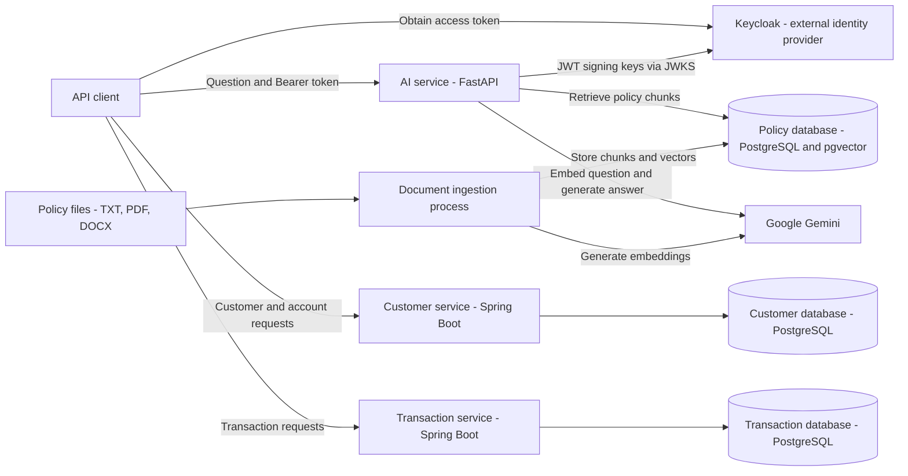
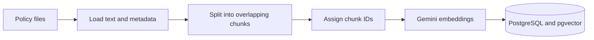
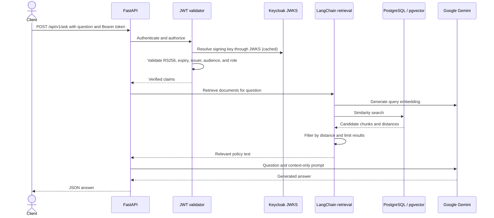
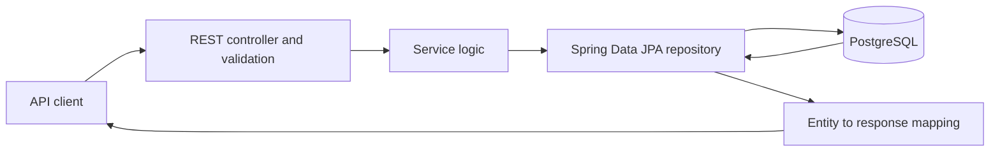

# AI Banking Support Assistant

A banking support project with **three backend services**: an AI assistant that answers questions using banking policy documents, a customer and account API, and a transaction API.

The assistant uses Retrieval-Augmented Generation (RAG): it retrieves relevant policy text from PostgreSQL/pgvector and supplies that context to Gemini to generate an answer.

## Services implemented so far

| Service | Responsibility | Technology | Local port |
| --- | --- | --- | --- |
| [ai-service](ai-service/) | Authenticated policy questions, document retrieval, answer generation | Python 3.12, FastAPI, LangChain, Gemini | `8000` |
| [customer-service](customer-service/) | Create and retrieve customers and their accounts | Java 21, Spring Boot 4.1.1 | `8081` |
| [transaction-service](transaction-service/) | Create transaction records and retrieve transactions by ID or account | Java 21, Spring Boot 4.1.1 | `8080` (Spring Boot default) |

PostgreSQL, Keycloak, and Gemini are supporting dependencies, separate from the three application services.

The services currently operate independently. The AI request path does not call the customer or transaction APIs; its answers use policy documents rather than live customer, balance, or transaction data. Transaction creation saves a record with `PENDING` status; payment execution and balance updates are not part of that flow.

## Architecture diagram



The database nodes represent separate configured databases, which can share a PostgreSQL server. Keycloak is referenced by the AI configuration; its deployment is not included in this repository.

## Workflow and request flow

### 1. Document ingestion

Ingestion runs separately from the question endpoint, through a Python command or Kubernetes Job.

1. Read files from `BANK_POLICY_FILES_PATH`, supporting `.txt`, `.pdf`, and `.docx`.
2. Load text and attach document ID and version metadata.
3. Split documents using LangChain's `RecursiveCharacterTextSplitter`, with configurable chunk size and overlap.
4. Assign chunk indexes and deterministic UUIDs based on document ID, version, and chunk index.
5. Generate Gemini embeddings and store text, metadata, and vectors through `PGVectorStore`.



The active ingestion command, run from `ai-service`, is:

```shell
python -m app.lagchain_rag.ingest
```

The directory is spelled `lagchain_rag` in the repository. Earlier manual RAG code remains under `app/rag` and `app/db`; the active question path uses LangChain.

### 2. AI question and answer



- The token must contain `rag:ask` under `resource_access.banking-ai-api.roles`.
- Missing or invalid credentials return `401`; insufficient permissions return `403`.
- Questions are trimmed and validated to contain 3–500 characters.
- Retrieval filters candidates by `RETRIEVER_DOCUMENT_MAX_DISTANCE` and returns up to `NUMBER_OF_DOC_RETURN` chunks. Current configuration uses 20 candidates, a maximum distance of 0.5, and up to 3 returned chunks.
- The prompt instructs Gemini to answer only from the retrieved context and state when information is insufficient. This behavior is prompt guidance rather than a separate deterministic answer check.

Example request:

```http
POST /api/v1/ask
Authorization: Bearer <access-token>
Content-Type: application/json

{"question": "Why might my transaction be declined?"}
```

Response shape:

```json
{"answer": "Generated answer based on the retrieved banking policy context."}
```

### 3. Customer and account workflow

1. The REST controller validates incoming requests.
2. Customer creation maps the request to an entity, saves it, and returns the ID and timestamps.
3. Account creation first looks up the customer, then generates an account number and saves an active account with zero balance and a daily transfer limit of `5000.00`.
4. Read requests query repositories and map entities to response objects. Exception handlers handle missing records.

### 4. Transaction workflow

1. The REST controller validates the transaction request.
2. The service maps it to an entity, sets its status to `PENDING`, and saves it.
3. Read endpoints retrieve a transaction by ID or list transactions for an account.
4. Entities are mapped to response objects; missing results are handled by the exception handler.

Both Java services follow this layered request path:



## API endpoints

Paths are relative to the corresponding service URL.

| Service | Method | Path | Purpose |
| --- | --- | --- | --- |
| AI | GET | `/api/v1/health` | Health response; no token required |
| AI | POST | `/api/v1/ask` | Policy question; authorized Bearer token required |
| Customer | POST | `/api/v1/customer/` | Create a customer |
| Customer | GET | `/api/v1/customer/{id}` | Retrieve a customer |
| Customer | POST | `/api/v1/customer/{customerId}/accounts` | Create an account |
| Customer | GET | `/api/v1/customer/{customerId}/accounts` | List a customer's accounts |
| Customer | GET | `/api/v1/{id}` | Retrieve an account by ID |
| Transaction | POST | `/api/v1/transactions` | Create a transaction record |
| Transaction | GET | `/api/v1/transactions/{transactionId}` | Retrieve a transaction |
| Transaction | GET | `/api/v1/accounts/{accountId}/transactions` | List transactions for an account |

FastAPI's interactive API documentation is available at `http://localhost:8000/docs` when running locally.

## Technology used so far

| Area | Technologies and use |
| --- | --- |
| AI API | Python 3.12 container, FastAPI, Uvicorn, Pydantic validation |
| RAG | LangChain document loaders and text splitters, Google GenAI embeddings integration, `langchain-postgres` (`PGEngine`, `PGVectorStore`) |
| Model access | Google Gen AI SDK for Gemini answer generation; configurable LLM and embedding model names |
| Document formats | Text files, PDF through `pypdf`, Word documents through `docx2txt` |
| Banking APIs | Java 21, Spring Boot 4.1.1, Spring Web, Jakarta Bean Validation |
| Java persistence | Spring Data JPA / Hibernate, PostgreSQL JDBC driver, Flyway SQL migrations |
| Java mapping and build | MapStruct 1.6.3, Lombok, Maven and Maven Wrapper |
| AI persistence | PostgreSQL, pgvector, SQLAlchemy, Psycopg; Alembic is listed as a dependency |
| Authentication | Keycloak-issued JWTs, PyJWT with cryptographic support, RS256, JWKS, role checks on the AI endpoint |
| Configuration and logging | Environment variables, `python-dotenv`, Python logging with configurable console/file output, Spring YAML configuration |
| Containers and deployment | Docker; Kubernetes Deployments, ClusterIP Services, ConfigMap, Secrets, persistent volume claims, ingestion Job, health probes |
| Testing | pytest for AI tests; Spring Boot test dependencies and application context tests for Java services |
| CI/CD | GitHub Actions, Docker Buildx, Docker Hub, self-hosted Windows runner, PowerShell, kubectl, Kustomize preview overlay |

## Deployment and CI/CD workflow

The [Kubernetes manifests](k8s/) currently cover the **AI service and PostgreSQL/pgvector infrastructure**, plus document storage and ingestion. Deployment manifests for the customer service, transaction service, and Keycloak are not included.

- The AI Deployment runs Uvicorn on port `8000`, loads configuration from a ConfigMap and Secret, and uses `/api/v1/health` for startup, readiness, and liveness probes.
- PostgreSQL uses `pgvector/pgvector:pg17` and persistent storage. Its referenced `banking-postgres-secret` must be supplied separately.
- A document loader Pod provides access to a shared documents volume. The ingestion Job mounts it and runs `python -m app.lagchain_rag.ingest`.
- The AI Service is `ClusterIP`; local access requires port forwarding or another configured access mechanism.
- The [AI CI workflow](.github/workflows/ai-service-ci.yaml) runs on pull requests targeting `main`. It validates the Docker build and publishes a PR-number/commit-tagged image to Docker Hub for same-repository pull requests. It does not currently run tests or deploy to Kubernetes.

### Continuous integration: build and publish

The **AI Service PR CI** workflow runs when a pull request targeting `main` is opened, updated, or reopened. It uses an `ubuntu-latest` runner to build the AI Docker image. For same-repository pull requests, it authenticates to Docker Hub using the `DOCKERHUB_USERNAME` and `DOCKERHUB_TOKEN` repository secrets and publishes:

```text
<DOCKERHUB_USERNAME>/ai-banking-service:pr-<PR_NUMBER>-<FULL_HEAD_SHA>
```

Fork pull requests receive build validation only. The published tag is the input for the separate CD workflow.

### Continuous delivery: deploy to preview

The [AI Service CD workflow](.github/workflows/ai-service-cd.yaml) is started manually through `workflow_dispatch`. It deploys an existing image to the `ai-service-preview` namespace; it does not rebuild the image or automatically run after CI or a merge.

```mermaid
flowchart LR
    PR[Pull request to main] --> CI[CI - build validation]
    CI -->|Same-repository PR| Hub[Docker Hub - tagged image]
    Hub --> Select[Manual CD run - select image_tag]
    Select --> Runner[Self-hosted Windows X64 runner]
    Runner --> Context[Verify Kubernetes context and nodes]
    Context --> Overlay[Set image in preview Kustomize overlay]
    Overlay --> Apply[Apply to ai-service-preview]
    Apply --> Rollout[Wait for rollout - 120 seconds]
    Rollout --> Verify[List deployments, pods, and services]
```



The deployment job performs these steps:

1. Check out the selected repository ref on a runner with labels `self-hosted`, `Windows`, and `X64`.
2. Run `kubectl config current-context` and `kubectl get nodes` to verify cluster access. The workflow uses the runner's configured context.
3. Replace the image placeholders in [the preview overlay](k8s/overlays/preview/kustomization.yaml) using `DOCKERHUB_USERNAME` and the required `image_tag` input.
4. Render the manifests with `kubectl kustomize k8s/overlays/preview`, then deploy with `kubectl apply -k k8s/overlays/preview`.
5. Wait for `deployment/ai-service-deployment` in `ai-service-preview` with a `120s` rollout timeout, then list deployments, pods, and services. A failed kubectl command fails the workflow.

### Required preview environment setup

| Requirement | Configuration |
| --- | --- |
| GitHub runner | Online self-hosted Windows X64 runner with PowerShell and `kubectl` available |
| Cluster access | Runner kubeconfig points to the intended cluster and has permission to apply preview resources and inspect nodes |
| Namespace | Create `ai-service-preview` beforehand; the overlay sets the namespace but does not include a Namespace resource |
| Image | Existing Docker Hub image tag from CI; configure `DOCKERHUB_USERNAME` as a repository secret |
| Image pull access | Cluster can pull the image; private repositories require separately configured registry credentials |
| Application secrets | Supply `banking-ai-secret` in `ai-service-preview`, including the required Gemini credentials and database connection configuration |
| Runtime dependencies | Reachable PostgreSQL/pgvector and Keycloak, with appropriate database, model, and authentication configuration |
| Policy data | Ingest the banking policy documents separately before testing policy answers |

The preview overlay includes the AI Deployment, Service, and ConfigMap. It does **not** provision Secrets, PostgreSQL, document storage, or the ingestion Job. Its ConfigMap and Secret references must resolve in the preview namespace, and their connection settings must reach the supporting services.

### Run and verify a preview deployment

1. Wait for the PR CI image publication to complete and copy its tag, such as `pr-42-<full-head-sha>`.
2. In GitHub **Actions**, select **AI Service CD**, choose **Run workflow**, select the repository ref containing the deployment manifests, and enter the tag as `image_tag` (without the repository name).
3. Review the workflow's rollout and resource verification output.
4. To access the preview locally, run:

```shell
kubectl port-forward service/ai-service-service 8000:8000 -n ai-service-preview
```

Open `http://localhost:8000/api/v1/health` or `http://localhost:8000/docs`. Testing `/api/v1/ask` also requires a valid token with the `rag:ask` role and ingested policy data.

CD currently verifies Kubernetes rollout and lists resources; it does not run an API smoke test, automatically roll back a failed deployment, or promote to production. To redeploy an earlier image, run CD again with its existing tag.

## Repository layout

```text
ai-banking-support-assistant/
|-- ai-service/             # FastAPI, JWT validation, RAG, ingestion, tests, Dockerfile
|-- customer-service/       # Spring Boot customer and account API
|-- transaction-service/    # Spring Boot transaction API
|-- k8s/                    # AI/PostgreSQL manifests and Kustomize preview overlay
|-- test_documents/         # Sample policy documents
|-- learning_doc/           # Learning notes and supporting material
`-- .github/workflows/      # AI Docker CI and manual Kubernetes preview CD
```
